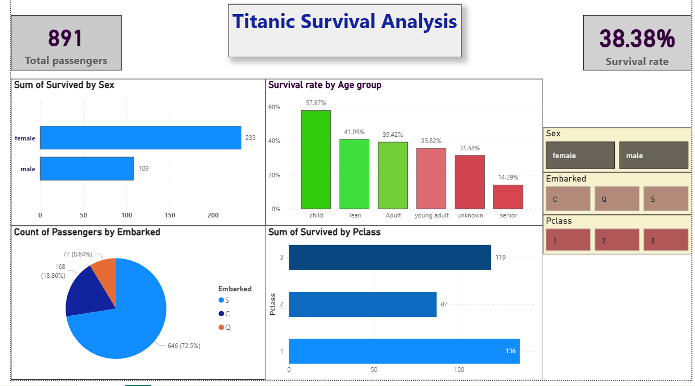

# Titanic Survival Analysis Dashboard (Power BI)

## 📌 Overview

This project analyzes the Titanic passenger dataset using Power BI. The objective was to explore survival patterns and identify the factors that influenced passenger survival through interactive visualizations and data storytelling.

## 🛠 Tools Used

- Power BI
- DAX
- Data Modeling
- Data Cleaning and Transformation

## 🔄 Workflow

1. Imported and cleaned the Titanic dataset
2. Performed data transformation and preparation
3. Created data model and calculated measures using DAX
4. Built interactive dashboards and visualizations
5. Analyzed survival trends across different passenger groups

## 📊 Key Insights

- Female passengers had a higher survival rate compared to male passengers.
- First-class passengers showed significantly higher survival rates than lower classes.
- Younger passengers had a better chance of survival compared to older passengers.
- Passenger class and gender were major factors influencing survival outcomes.

## 📷 Dashboard Preview

## 📈 Dashboard Features

- Overall Survival Rate Analysis
- Survival by Passenger Class
- Survival by Gender
- Survival by Age Group
- Interactive Filters and Slicers
- Visual Storytelling with KPIs and Charts

## ▶️ How to Use

1. Download the `.pbix` file from this repository.
2. Open it using Power BI Desktop.
3. Use the available slicers and filters to explore survival patterns.
4. Interact with charts to gain deeper insights into passenger demographics.

## 📂 Repository Structure

- `Titanic_Survival_Analysis.pbix`
- `dashboard.png`
- `README.md`

## 🎯 Business Value

This project demonstrates data visualization, dashboard development, data modeling, and analytical storytelling skills using Power BI. It showcases the ability to transform raw data into meaningful insights through interactive reporting.

---

⭐ If you found this project interesting, feel free to explore the dashboard and provide feedback.

